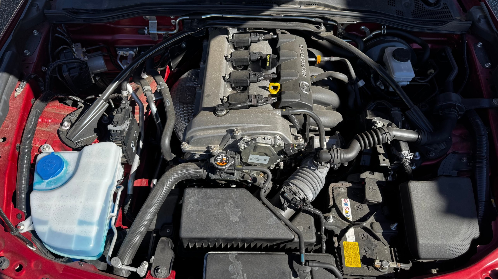

# Engine air filter

| | |
|---|---|
| **Car** | 2021 Mazda MX-5 (ND2) Grand Touring, US market |
| **Skill level** | First-timer. This is the best first job on the car |
| **Time** | ⚠️ To be replaced with a timed hands-on figure. Expect minutes, not hours |
| **Tools** | Possibly a screwdriver or a small socket, depending on how the airbox lid is held (⚠️ to confirm on the car), a clean rag, a flashlight, gloves are optional |
| **Parts and fluids** | A replacement engine air filter that matches your car (⚠️ part number to confirm). Nothing else |
| **Interval** | Mazda says replace at 36 months on both schedules, with a mileage backstop. We look at it every quarter. See the [schedule](schedule.md) |
| **Helper jobs** | Almost the whole job, with an adult in charge. A kid can fetch the tools, hold the old filter up to a bright light, compare it with the new one, tap out loose dust outdoors, and write the log entry. The adult opens the airbox and puts the filter back, because that is the step with consequences. Hood up, engine off and cool, always |

## Safety

- **Engine off and cool.** Park, shut it off, and give it time. The airbox sits near hot parts, and fans can start on their own.
- **Nothing goes into the intake.** The airbox feeds the engine directly. A dropped screw, a rag, or a leaf in the intake is a much bigger problem than a dirty filter. Keep tools and rags out of the open airbox, and count what you took out against what you put back.
- **Never start the engine with the airbox open or the filter out.** Unfiltered air is how grit gets into cylinders.
- **Keep your hands off the sensors.** A sensor in the intake path measures the air going in, and it is easy to damage and expensive to replace. Look at it. Do not poke it or spray anything near it. ⚠️ Location to confirm and photograph.
- **Keep helpers clear of hot or moving parts.** Small hands and a hood prop are a pinch hazard. Use the prop and mind fingers.

## Why this exists

An engine breathes. At highway speed it pulls thousands of litres of air per minute through the filter, and the filter's job is to catch the dust, pollen, and grit that would otherwise score the cylinder walls and foul the sensors downstream. A clean filter passes air easily. A loaded filter is a restriction, and the engine has to work against it.

The filter does its job by getting dirty, which means a dirty filter is not a failed filter. It is a working one. The question is how loaded is too loaded, and you only learn that by looking at one every few months and remembering what the last one looked like. That is the same lesson as every other guide here: the skill is noticing drift from normal.

Mazda's US tables say to replace the air filter at 36 months. Schedule 1 puts the matching mileage at 36,000 km (22,500 miles), and Schedule 2 puts it at 48,000 km (30,000 miles). The footnote on Schedule 2 adds that in very dusty or sandy areas you should clean the filter and replace it if necessary more often than that. The calendar number matters even on a car that does not move much, because the paper ages and a car that sits gathers dust, damp, and sometimes a nesting visitor.

## What healthy looks like

- **The airbox is closed and sealed.** The lid sits flat, the clips or fasteners are all in place, and the hose connecting it to the engine is tight and not cracked.
- **The inside is dry and clean.** No oil film, no standing water, no leaves, no chewed material.
- **The filter is the color of paper that has been used.** A little gray at the edges of the pleats is ordinary. You can still see the pleats clearly.
- **Light gets through.** Hold it up to a bright light and you can see the glow through the paper.

## Old versus new

Put the old filter next to the new one in daylight. This is the easiest old-versus-new comparison on the whole car.

- **New:** even, pale paper, with sharp, clean pleats and a straight, undamaged seal around the frame.
- **Worn out or needs work:** gray or brown pleats packed with dust, a surface you can no longer see through, visible debris or leaf bits, an oily or damp look, a crushed or torn pleat, or a seal that is flattened or cracked.

The light test is the fastest check. Hold the filter flat against a bright window or a flashlight. If you cannot see light through most of the paper, it is loaded. ⚠️ Photos of a healthy filter, a worn one, and the new one side by side belong here once we have them.

## Where things are

*The airbox is the large black box low in the engine bay. The ribbed hose leads from it to the throttle body.*

## Steps

1. **Park and cool.** Level ground, engine off, hood up and propped.
2. **Look before you touch.** Find the airbox. Check that the lid is seated, that nothing is hanging off it, and that the hose to the engine is tight. This is your before picture. The airbox is the large black box low in the engine bay, shown in the photo above.
3. **Open the lid.** Release the clips or remove the fasteners that hold it, whichever your car has. Lift the lid away without twisting the hose. Note how it is held so you can put it back exactly. ⚠️ Fastener type and count to confirm.
4. **Note the orientation, then lift out the filter.** Notice which way it faces and how its edge seats, because the new one goes in the same way.
5. **Look into the box.** Wipe loose debris out of the lower part with a rag, working carefully and keeping everything on the dirty side of the box. Do not let anything fall toward the engine side. If you find water, oil, or a lot of debris, find out where it came from before you go on.
6. **Judge the old filter.** Do the light test. Check the pleats and the seal. Compare it with the last one if you kept it.
7. **Decide.** If the filter is within Mazda's calendar number and passes the light test, put it back. If it fails the light test, it is past 36 months, or it looks bad, replace it. In very dusty conditions Mazda says to clean it and replace more often. ⚠️ Our own practice on cleaning versus replacing is open.
8. **Seat the filter.** Put the new filter in the same way the old one came out. The edge must sit flat all the way around, because a filter that sits crooked lets unfiltered air past the seal.
9. **Close the lid.** Seat it fully, refit every clip or fastener, and run a finger around the seam to check it is flush.
10. **Check the hose.** Make sure the connection to the engine is tight and is exactly as you found it.
11. **Start the engine.** Listen. It should idle and respond as usual. Look at the airbox and hose for anything that moved.
12. **Log it.** Write down the date, the mileage, and what you saw.

## What about a cabin filter?

The ND does not come with a traditional cabin filter. It does have a housing for one. According to the installation guide for Flyin' Miata's aftermarket kit, there is a filter door behind the dash on the passenger side, and inside it sits a factory mesh screen. That screen is a coarse debris screen, not a fine dust and pollen filter. The kit swaps in a real filter and adds a second mesh screen at the cowl air inlet.

Whether that counts as a cabin filter is a fair argument. It sits on the fresh-air path that feeds the vents, so by function it is one. But a filter there only treats air that comes through the vents, and on an open-top car most of the air around you never does. With the top down it does very little. It earns its keep mainly with the top up and the heater or air conditioning running, which makes it a modest benefit for a car like this, not a maintenance gap.

Getting to the housing is a large job. The kit's guide has you remove the passenger A-pillar trim, the door threshold, the kick panel, and the lower dash panel, and unplug five harness connectors. The cowl screen half is much simpler. Adding either is a modification, so both belong in the future upgrade section. If you add a filter, it becomes a maintenance item with its own yearly look, and it would get its own guide. ⚠️ We have not seen the factory mesh screen on our own car.

## While the hood is up: the quarterly look

You are already here, so take a minute for the rest of the quick look. Check that the connectors on the ignition coils are fully seated and their clips are intact, that wiring is not rubbing or cracked, and that nothing looks wet, oily, or different from last time. The four coils sit in a row on top of the valve cover with no cover over them, so you can see them as soon as the hood is up. Once a year you take it further and pull the plugs, which is covered in the [spark plug guide](spark-plugs-and-coils.md).

## When it goes wrong

- **A clip breaks or a fastener is lost.** Do not drive with a loose lid. Replace the part before you drive anywhere.
- **The lid will not seat.** Something is crooked. Take the filter out and reseat it.
- **Oil or water in the airbox.** This is not a filter problem. Find the source before you put a new filter in.
- **Rodent debris or nesting material.** Remove it carefully, check the intake path for leftovers, and inspect the wiring nearby, because rodents chew insulation.
- **The engine idles rough or the check engine light comes on after the change.** The most likely cause is a hose that is not seated or a lid that is not sealed. Recheck both before you suspect anything else.

## Log it

Write down the date, the mileage, a note on the filter's condition, and whether you replaced it. If you kept the old filter, put the date on it. A shelf of dated filters is a good way to teach a kid how fast things get loaded.

## Verification

Last checked: 2026-10-19

Primary source: the 2021 Mazda MX-5 owner's manual (US edition, document code MX-5_8JS9-EA-20K, Edition 1), read directly from the PDF.

| Item | Value | Source | Status |
|---|---|---|---|
| Replacement interval, Schedule 1 | 36 months or 36,000 km (22,500 miles), then again at 72 months | Manual, Scheduled Maintenance, Schedule 1 (US) | Verified |
| Replacement interval, Schedule 2 | 36 months or 48,000 km (30,000 miles), then again at 72 months | Manual, Scheduled Maintenance, Schedule 2 (US) | Verified |
| Dusty or sandy conditions | Clean the filter and replace if necessary more often than the recommended interval | Manual, Schedule 2 remarks, note 1 | Verified |
| Cabin or pollen filter | The owner's manual does not describe one, and Flyin' Miata states the ND has no factory cabin air filter, though there is a housing behind the dash that holds a coarse factory mesh screen | Manual search found no entry. [Flyin' Miata product page](https://flyinmiata.com/products/nd-cabin-air-filter) | Community and hands-on. Owner experience across the ND series agrees: no traditional cabin filter |
| Factory housing and mesh screen | The kit's guide describes a filter door behind the passenger-side dash with an existing mesh screen inside, which is removed when the new filter goes in | [Flyin' Miata install guide (PDF)](https://s3.us-west-1.amazonaws.com/instructions.flyinmiata/interior_21/ND_cabin_air_filter_M21-30040.pdf) | Community, vendor document. The guide's photos agree with the text: the housing sits behind the lower dash panel in the passenger footwell area, with a door held by a lock tab on each side. ⚠️ Not seen on our car |
| Aftermarket cabin filter kit | Flyin' Miata sells a kit with a cowl intake screen and a filter, installed behind the dash, and suggests replacing it about once a year | Same page | Community, vendor claim. Upgrade topic, not maintenance. We have not installed one |
| Airbox location, fasteners, and filter part number | Not in the owner's manual | Needs hands-on inspection or Mazda service information | ⚠️ Open |
| Light test for judging a filter | Hold the filter against a bright light and look for glow through the paper | General practice, widely used | Community, hands-on to confirm |
| Sensor in the intake path | Described only in general terms | General knowledge | ⚠️ Location and name to confirm on the car |

**Still open (⚠️):** the lid fasteners, the replacement filter part number, our own cleaning-versus-replacing practice, a timed hands-on duration, and photos of a healthy filter, a worn one, and a new one.
