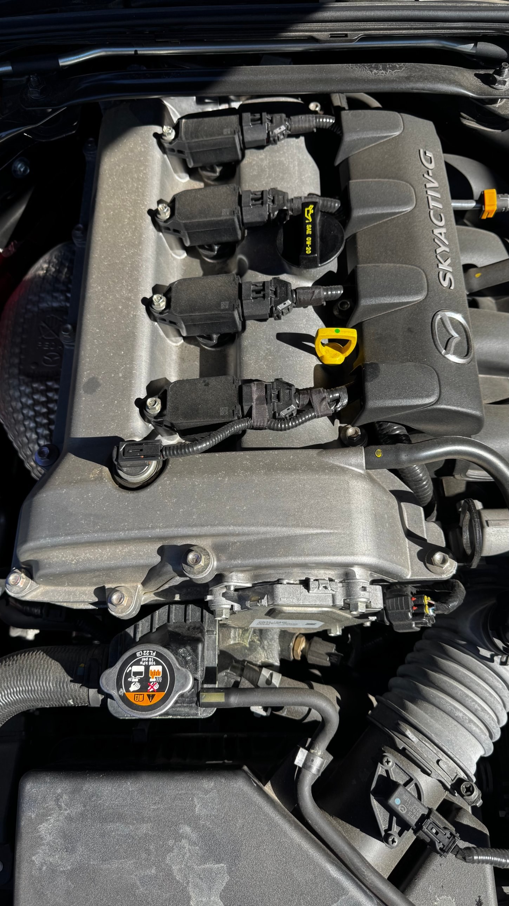

# Spark plugs and coils

| | |
|---|---|
| **Car** | 2021 Mazda MX-5 (ND2) Grand Touring, US market |
| **Skill level** | Comfortable. The work is simple, but a dropped plug, a cross-threaded plug, or debris in a cylinder is expensive, so care matters more than skill |
| **Time** | Plan on about an hour to an hour and a half the first time, plus time for the engine to cool completely beforehand (⚠️ estimate, to be replaced with a timed hands-on figure) |
| **Tools** | Spark plug socket (16 mm, which is 5/8 inch) on an extension, ratchet, 8 mm socket for the coil bolts, torque wrench, gloves, flashlight, a tray or egg carton to keep the plugs in cylinder order, a gapping tool if you adjust the gap, rags, and a brush, vacuum, or compressed air to clear the plug wells before you pull a plug |
| **Parts and fluids** | A set of four plugs. Mazda lists genuine plug numbers PE5R-18-110 or PE5S-18-110. We run NGK ruthenium plugs. We also use dielectric grease inside the coil boots and a small amount of anti-seize on the plug threads (⚠️ see the anti-seize note in step 10) |
| **Interval** | Mazda says replace every 75,000 miles (120,000 km) on both schedules. Our practice is a quick look at the coil connections every quarter, and a yearly pull to read the plugs. See the [schedule](schedule.md) |
| **Helper jobs** | With an adult in charge, a kid can lay out the tray with four cylinder numbers, set each plug in its slot as it comes out, hold the light, compare old plugs with a new one, and write the log entry. Adults only: pulling coils, working the socket, gapping, torquing, and anything near a hot engine |

## Safety

- **Cold engine only.** The plugs sit in an aluminum head, and a hot head is easier to damage and easier to burn yourself on. Let the car sit for hours, not minutes.
- **Nothing falls into a cylinder.** Clear the plug wells before you pull a plug. A screw, a bit of grit, or a leaf that drops into an open plug hole can score a cylinder wall. Keep the openings covered between steps.
- **Do not drop a plug.** Ceramic cracks, and a hairline crack inside the insulator will not show until the car misfires. Retire any plug that has been dropped.
- **Start every plug by hand.** A plug threaded crooked ruins the thread in the head, and that is a very expensive repair. If it does not turn smoothly with your fingers, back it out and start over.
- **Do not wire-brush the plugs.** Mazda's manual says wire brushes can damage the coating on iridium and platinum tips. That applies to any fine-wire plug.
- **Keep helpers clear.** Sockets, extensions, and small plugs on a tray are choking and cut hazards for little hands.

## Why this exists

A spark plug has one job: at the right instant, it puts a spark across a small gap and lights the fuel and air in the cylinder. That sounds minor, but the conditions are brutal. The ND2's 2.0 L engine runs a compression ratio of 13.0, which is high, so each spark has to jump a gap in dense air, thousands of times a minute, with the cylinder at high pressure and temperature. The tips wear a tiny amount with every spark.

Plugs fail slowly. As the electrode wears, the gap grows, the coil has to build more voltage to jump it, and the margin shrinks. Nothing happens until the margin runs out, and then you get a misfire, rough running, or a lazy start. The key here is that the plug is only part of the story. The coil packs sit directly on top of the plugs, there is one per cylinder, and the coil, the boot that seals around the plug, and the electrical connector all belong to the same ignition circuit. A loose connector or a cracked boot can look exactly like a worn plug.

That is why we check the connections on a rhythm and pull the plugs on a different one. A quick look at the coil connectors and clips every quarter, every time you open the hood, catches loose or damaged parts before they become a misfire. Once a year, pulling the plugs lets you read them, and a plug is a small report on what happened inside that cylinder. Mazda sets the replacement at 75,000 miles. A yearly pull is not about replacing them. It is about knowing what normal looks like for your engine, so that a change shows up long before the interval.

## What healthy looks like

*The four coils on a healthy engine: one connector and one bolt per coil, no cover over them.*

- **Coil connectors are fully seated and clipped.** Each coil has a connector and a retaining clip. They should click into place and not wiggle.
- **Coil bodies and boots are clean and intact.** No cracks, no oil or coolant residue, no chafed wiring.
- **The plug wells are dry.** Oil in a plug well is a leak from the valve cover gasket or a plug tube seal.
- **The plug insulator is tan to light gray.** A pale, even color means the cylinder is burning clean.
- **The electrode has sharp edges and the gap looks even.** The center tip and the ground tip are flat and square, with no melting, no chipping, and no heavy build-up.
- **All four plugs look alike.** If one differs from the other three, that cylinder is telling you something.
- **The engine idles smoothly and starts promptly.** That is the whole point.

## Old versus new

Set the old plugs beside a new one on the tray, in cylinder order, in good light.

- **New:** a clean white or pale insulator, sharp square electrode edges, and a gap that matches the specification.
- **Worn out or needs work:** rounded, eroded electrode edges and a gap wider than spec. Deposits matter too. Black, dry soot points to a rich mixture. Wet black means oil. White or blistered means heat. A chipped or cracked insulator means damage. One plug that looks different from the others points at that cylinder.

Bring the new plug and the old plug together under a light and look at the tips. A kid can see the difference in a few seconds, and that is the lesson: wear is gradual, and you only see it by comparison. ⚠️ Photos of a healthy plug, a worn one, and a new one belong here once we have them.

## Steps

1. **Check what you have.** Plugs, the socket and extension, the torque wrench, a tray labeled one to four, and a clean working area. Know where the coil connectors are before you start.
2. **Cold engine.** Park, shut off, and let it cool completely. There is no engine cover over the coils on the ND2. The four coils sit in a row on top of the valve cover, each with its connector and one bolt, so you can see them as soon as you open the hood.
3. **Work one cylinder at a time.** This keeps the plugs and coils matched to their cylinders, so what you read is what that cylinder did. Our order runs from the rear of the engine to the front.
4. **Disconnect the coil.** Unclip and unplug the electrical connector, then remove the coil's single 8 mm retaining bolt and pull the coil straight up. Do not twist and yank on the wiring.
5. **Clear the plug well.** With the coil out, blow or vacuum the well so nothing falls into the cylinder when the plug comes out.
6. **Remove the plug.** Seat the 16 mm socket on the extension fully on the plug and turn it counterclockwise. The plug should come free smoothly. Put it in its slot on the tray.
7. **Read the plug.** Look at the insulator color, the electrode wear, and any deposits. Compare it with the other cylinders as you go.
8. **Decide.** If the plug is within interval and looks healthy, you can put it back. If it is at or past the interval, or it looks worn or fouled, replace it. We replaced the plugs when we bought the car, at about 19,000 miles, along with the other wear items and fluids. The next replacement on Mazda's 75,000-mile interval falls at roughly 94,000 miles, so the yearly pull is a reading exercise and not a replacement.
9. **Check the gap.** If you are fitting a new plug, check its gap against the specification before you install it. Use a proper gapping tool, because the fine tips are easy to damage. ⚠️ Gap for the plug we run to be confirmed from a primary source. The retailer lists 0.044 inch.
10. **Install by hand first.** Thread the plug in with your fingers, then seat it with the socket. Stop if it resists. We put a small amount of anti-seize on the threads. ⚠️ Plug makers such as NGK commonly say that plated plugs do not need anti-seize and that it can lead to over-torquing, because it changes how much clamping force a given torque produces. We have not verified NGK's current wording, so treat the torque figure below as a starting point if you use it.
11. **Torque it.** Use a torque wrench. A published figure is 11 to 17 ft-lbs (about 15 to 23 N·m). ⚠️ That figure comes from an uncited third-party page, so confirm it in Mazda service information before we call it verified.
12. **Refit the coil.** Press it fully onto the plug, refit its bolt, and plug in the connector until the clip clicks. Put a thin film of dielectric grease inside the coil boot before you press the coil on, and check that the boot is seated.
13. **Move to the next cylinder.** Repeat for the other three.
14. **Start and check.** Start the engine. It should idle smoothly. Look and listen for any misfire.
15. **Log it.** Write down the date, the mileage, what each plug looked like, and which cylinder each one came from.

## When it goes wrong

- **Misfire or rough idle after the job.** The usual cause is a coil connector that is not fully seated, or a coil not fully pressed onto its plug. Recheck both before anything else.
- **Check engine light after the job.** The same causes apply. Read the code if you can, because it will name the cylinder.
- **A plug will not come out.** Stop. Do not force it. Spray penetrant is not an option you want near a cylinder. Get advice, because a stripped thread in the head is expensive.
- **Oil in the plug well.** A leaking valve cover gasket or plug tube seal. The plug and coil may also be oil-soaked. Fix the leak, then clean or replace the affected parts.
- **One plug looks different from the others.** Note the cylinder. Recheck it at the next yearly look, and if the difference is large, find out why.
- **A cracked or dropped plug.** Replace it. Do not reinstall it.

## Log it

Write down the date, the mileage, the plug brand and number, and the condition of each plug by cylinder. Photograph them beside each other if you can. A shelf of dated photographs is the best baseline a Miata owner can have.

## Verification

Last checked: 2026-10-19

Primary source: the 2021 Mazda MX-5 owner's manual (US edition, document code MX-5_8JS9-EA-20K, Edition 1), read directly from the PDF.

| Item | Value | Source | Status |
|---|---|---|---|
| Replacement interval | Every 120,000 km (75,000 miles) on both Schedule 1 and Schedule 2 | Manual, Scheduled Maintenance tables, US | Verified |
| Genuine plug numbers | PE5R-18-110 or PE5S-18-110 | Manual, Specifications chapter, Electrical System | Verified |
| Do not wire-brush iridium or platinum tips | The fine coating on the tips can be damaged | Manual, Specifications chapter | Verified |
| Compression ratio | 13.0 | Manual, Specifications chapter, Engine | Verified |
| Plug socket size | 16 mm (5/8 inch) | Hands-on | Hands-on |
| Pulling the plugs once a year to read them | Our routine | Hands-on | Our practice |
| Quarterly look at coil connections and clips | Our routine | Hands-on | Our practice |
| NGK ruthenium set | Flyin' Miata SKU 04-56222 for the naturally aspirated ND, heat range 7, gap 0.044 inch, listed as a stock-spec replacement, with a claimed life of 80,000 to 100,000 miles | [Flyin' Miata listing](https://flyinmiata.com/products/ngk-ruthenium-spark-plugs-nd-set-4) | Community, vendor listing. The lifespan is a vendor claim. ⚠️ Not checked against Mazda's plug |
| Plug torque | 11 to 17 ft-lbs | [Miata Nuts torque list](https://miatanuts.com/2024/07/24/here-are-some-of-the-most-common-torque-specifications-for-the-mazda-miata-nd-2016-and-newer/). The page cites no source and does not separate ND1 from ND2 | Community, uncited. ⚠️ Confirm in Mazda service information |
| Gap and torque | The owner's manual gives neither | Needs Mazda service information or hands-on measurement | ⚠️ Open |
| Engine cover | None over the coils. Four coils in a row on the valve cover | Hands-on, owner's engine bay photos | Hands-on |
| Coil bolt | One 8 mm bolt per coil, one connector per coil | Hands-on, owner's engine bay photos | Hands-on |
| Order of work | One cylinder at a time, from the rear of the engine to the front | Hands-on | Our practice |
| Dielectric grease on the boots | Used | Hands-on | Our practice |
| Anti-seize on the plug threads | Used | Hands-on | Our practice. ⚠️ Plug makers commonly advise against it on plated plugs, and we have not verified NGK's current wording |
| Plugs replaced at purchase | About 19,000 miles, with the other wear items and fluids | Hands-on | Hands-on |

**Still open (⚠️):** the plug gap and torque from a primary source, the manufacturer's position on anti-seize for the plug we run, a timed hands-on duration, and photos of healthy, worn, and new plugs.
